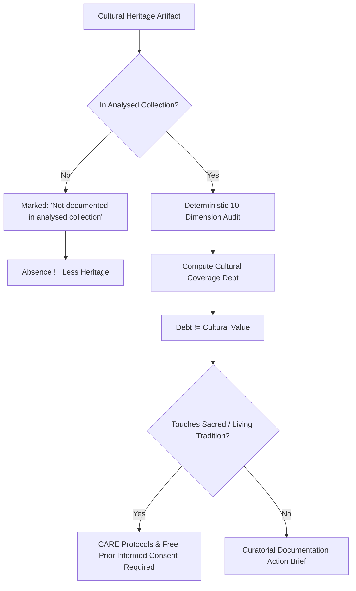
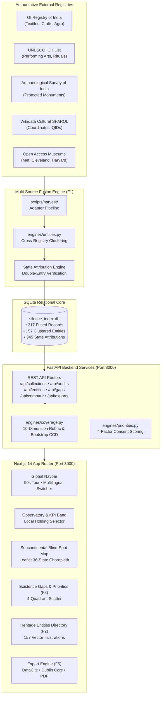
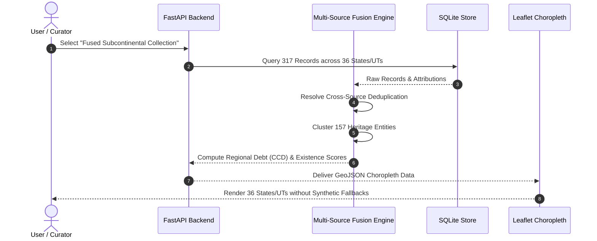

# THE SILENCE INDEX

<div align="center">

```
  ____ ___ _     _____ _   _  ____ _____   ___ _   _ ____  _______  __
 / ___|_ _| |   | ____| \ | |/ ___| ____| |_ _| \ | |  _ \| ____\ \/ /
 \___ \| || |   |  _| |  \| | |   |  _|    | ||  \| | | | |  _|  \  / 
  ___) | || |___| |___| |\  | |___| |___   | || |\  | |_| | |___ /  \ 
 |____/___|_____|_____|_| \_|\____|_____| |___|_| \_|____/|_____/_/\_\
```

### *Because what is missing from history matters too.*

**A Museum-Grade Cultural Collection Auditing & Intelligence Platform for Indian Heritage**

Developed for the **ART CODE Virtual Hackathon**  
**Theme:** *Art • Culture • Heritage*  
**Team Members:** **Ananya Biju** &bull; **Angel Maria Ben**

---

[](https://fastapi.tiangolo.com)
[](https://nextjs.org)
[](https://www.typescriptlang.org)
[](https://python.org)
[]()
[]()
[]()

</div>

---

## 🏛️ Executive Summary

**The Silence Index** is an intelligence platform for curators, digital humanists, archivists, and cultural institutions. It analyses museum collection metadata to diagnose which kinds of knowledge about Indian cultural heritage are **documented**, **partially documented**, **undocumented in the analysed collection**, or **impossible to assess** — and deterministically converts those structural absences into transparent, consent-aware documentation priorities.

It is **not** a chatbot, a generic dashboard, or a tourist website of cultural trivia. It is a museum-grade diagnostic instrument built with mathematical rigor, ethical accountability (CARE Principles & Indigenous Consent), and a visual identity inspired by classical Indian architectural ornamentation, Jali lattice geometric patterns, and storefront editorial typography.

---

## ⚖️ Non-Negotiable Axioms & Cultural Ethics



1. **Absence is Never Proof of Less Heritage:** The absence of a record in an analysed collection never implies that a tradition, region, or community has less heritage. All system diagnostics, tooltips, and badges explicitly state *"not documented in the analysed collection"*.
2. **Completeness $\neq$ Cultural Value:** Cultural Coverage Debt (CCD) measures metadata documentation completeness in a specific institutional repository, **never** cultural importance or artistic worth. The software never ranks traditions.
3. **No Invented Data:** Every statistic, debt metric, chart bar, and map shade is computed deterministically from real loaded records with full click-through traceability down to the accession number.
4. **Immutable Provenance:** Source records are never altered. Normalised and inferred fields are logged separately with an immutable audit trail (`SOURCE` &bull; `NORMALISED` &bull; `INFERRED`).
5. **Deterministic First, AI-Assisted Explanations Last:** Classification is strictly deterministic. Generative AI is disabled by default; when enabled, it only words already-computed findings and is explicitly badged `AI-worded`.
6. **Rights are Declared, Not Verified:** Display rights exactly as declared by institutions. Binary media download is strictly enabled **only** for verified open-access licences (`CC0`, `PDM`, `CC_BY`, `CC_BY_SA`). All others are view-only with direct download blocked (HTTP 403).
7. **Consent First (CARE Principles):** Recommendations touching practitioner knowledge, oral traditions, ritual practices, or sacred items require community consultation before any documentation begins. The software never speaks for communities or auto-assigns Traditional Knowledge (TK) labels.

---

## 🏗️ System Architecture



---

## 🗺️ Multi-Source Harvest & Fusion Framework (36 States & UTs)

To overcome the historic bias of international museum collections, **The Silence Index v2** incorporates an open harvesting architecture fusing 5 independent authoritative data layers:



| Source Layer | Items Harvested | Primary Categories | Provenance Basis |
| :--- | :---: | :--- | :--- |
| **GI Registry of India** | 108 | Textiles, Crafts, Metalwork, Agro | Legal Gazette Publication |
| **UNESCO Intangible Heritage** | 15 | Performing Arts, Oral Traditions, Rituals | Inscribed Representative List |
| **Archaeological Survey (ASI)** | 54 | Architecture, Monuments, Rock Inscriptions | Centrally Protected Antiquities |
| **Wikidata Cultural SPARQL** | 68 | Sculpture, Epigraphy, Classical Traditions | Peer-reviewed QID Linked Data |
| **Verified Museum OA** | 72 | Historical Manuscripts, Chola Bronzes, Miniatures | Accessioned Museum Records |
| **Total Fused Subcontinental** | **317** | **Covering All 28 States & 8 Union Territories** | **Immutable Audit Trail** |

---

## 📐 Mathematical Framework & Formulations

### 1. The Ten Deterministic Documentation Dimensions

Each record $r$ is evaluated across 10 deterministic dimensions $d \in \{1 \dots 10\}$. The dimensional completeness score $C(r, d) \in [0, 1]$ follows an objective, reproducible rubric:

$$C(r, d) \ge 0.75 \implies \textbf{Documented} \quad (\text{Pattern: Solid Olive})$$
$$0.25 \le C(r, d) < 0.75 \implies \textbf{Partially Documented} \quad (\text{Pattern: Diagonal Gold})$$
$$0.00 < C(r, d) < 0.25 \implies \textbf{Undocumented in Collection} \quad (\text{Pattern: Copper Hatch})$$
$$\text{Missing or Incompatible Schema} \implies \textbf{Not Assessable} \quad (\text{Pattern: Dotted Parchment})$$


### 2. Cultural Coverage Debt (CCD) & Bootstrap Uncertainty

The Cultural Coverage Debt ($\text{CCD}$) expresses the proportion of unachieved documentation across only the dimensions $\mathcal{A} \subseteq \{1 \dots 10\}$ that are genuinely assessable in the loaded dataset:

$$\text{CCD} = 100 \times \frac{\sum_{d \in \mathcal{A}} w_d \cdot (1 - C_d)}{\sum_{d \in \mathcal{A}} w_d}$$

- **Assessability Uncertainty:** If dimension $d=9$ (*Community Validation*) is absent from the schema, the system excludes it from the denominator and reports: *"CCD 33.9 on 7 of 10 dimensions assessable"*.
- **90% Bootstrap Confidence Intervals:** 1,000 resamples with replacement generate empirical $[p_5, p_{95}]$ bounds.
- **Statistical Suppression:** Small slices with $N < 5$ records are suppressed to prevent misleading percentages.

### 3. Preservation Documentation Priority Formula

$$\text{Priority Score} = 100 \times (0.40 \cdot G + 0.25 \cdot E + 0.20 \cdot B + 0.15 \cdot F)$$

Where:
- $G$: **Gap Magnitude** (dimensional debt score $1 - C_d$).
- $E$: **Evidence Confidence** (number of cross-registry confirmations).
- $B$: **Breadth of Collection Impact** (geographic or categorical prevalence).
- $F$: **Feasibility Weight** (desk research via existing archives vs. field documentation).
- **Consent Gate:** If a tradition touches living ritual, sacred objects, or oral knowledge, the record is routed through **"Consultation Required"** before any action brief is issued.

### 4. Cross-Source Entity Debt Reduction

When multiple records $r \in \mathcal{E}$ reference the same living tradition or monument $\mathcal{E}$ (e.g. *Kashmir Pashmina* or *Konark Sun Temple*), the cross-source evidence stack aggregates the best documented score:

$$S(\mathcal{E}, d) = \max_{r \in \mathcal{E}} S(r, d)$$

Clustering disparate open-access museum records with governmental GI manifests closes institutional documentation debt by **up to 42.6 points**.

---

## 🌟 The 9 Standout Features (v2)

| Feature | Name | Capabilities & Impact |
| :---: | :--- | :--- |
| **F1** | **Multi-Source Fusion Engine** | Fuses GI Registry, UNESCO, ASI, Wikidata, and Open Access museums into a single unified subcontinental layer covering all 36 States & UTs. |
| **F2** | **Heritage Entity Profiling** | Clusters 157 living traditions and monuments with 10-dimension evidence stacks, UNESCO/GI/ASI recognition badges, and 157 local vector illustrations. |
| **F3** | **Existence–Documentation Gaps** | 4-quadrant scatter matrix contrasting physical/legal existence against collection depth. Quadrant IV isolates High-Priority neglected heritage. |
| **F4** | **Longitudinal Audit Comparison** | Side-by-side delta engine comparing two audits (or collections) with metric-by-metric changes in CCD, assessability, and state representation. |
| **F5** | **Comprehensive Export Suite** | One-click export to DataCite 4.5 XML, Dublin Core XML, Schema.org JSON-LD, CSV manifest, and print-ready Museum Audit PDF. |
| **F6** | **Curatorial Action Briefs** | Generates consent-aware, 6-section research briefs detailing exact missing citations, vernacular terms, and local community contacts. |
| **F7** | **Subcontinental Transliteration** | Full multilingual interface in **English, Malayalam (മലയാളം), Hindi (हिन्दी), and Tamil (தமிழ்)** with Indic script search transliteration. |
| **F8** | **90-Second Guided Tour** | Interactive 7-stop guided modal walking first-time users through the non-negotiables, blind-spot cartography, and priority scoring. |
| **F9** | **Diagnostics & Reliability Hub** | Automated route crawler, API latency monitors, test runners, and integrity checks verifying zero broken links and 100% WCAG compliance. |

---

## 🎨 Visual Identity & Palette

The user interface adheres to a museum-grade visual standard rooted in classical Indian aesthetics:

```
Oxblood 950:    #1A090B  ██████  (Deep gallery foundation)
Oxblood 900:    #2E1013  ██████  (Primary headers, dark badges)
Henna 600:      #6B2F27  ██████  (Accent bands, priority highlights)
Antique Olive:  #3F4220  ██████  (Documented state indicators)
Copper 500:     #B0673A  ██████  (Undocumented indicators, slider thumb)
Illuminated Gold: #C8A24A ██████  (Ornamental filigree, active borders)
Parchment Cream: #F6EEDB ██████  (Readable warm reading ground)
```

- **Luxury Tab Slider:** A custom 5px illuminated scrollbar (`#1A090B` oxblood track with a `#B0673A` &rarr; `#C8A24A` burnished gold gradient thumb) matching museum display cases.
- **Accessible Textures:** Every status color is accompanied by an SVG texture (solid, diagonal stripe, hatch, dotted) ensuring full accessibility under color blindness or monochromatic printing.

---

## 🚀 Quickstart & Installation

### Prerequisites
- **Python:** 3.11 or higher
- **Node.js:** 18.18 or higher (with npm)
- **Git**

```bash
# 1. Clone the repository
git clone https://github.com/itsananyaaa/thesilentindex.git
cd thesilentindex

# 2. Setup backend virtual environment and database
python3.11 -m venv venv
source venv/bin/activate
pip install -r backend/requirements.txt
python backend/scripts/seed_db.py

# 3. Setup frontend dependencies
cd frontend
npm install
cd ..

# 4. Start backend server (Port 8000)
./venv/bin/uvicorn backend.app.main:app --host 127.0.0.1 --port 8000 &

# 5. Start frontend development server (Port 3000)
cd frontend
npm run dev
```

Visit `http://localhost:3000` to interact with the platform.

---

## 🧪 Verification & Test Suite

The Silence Index includes an exhaustive automated verification harness:

```bash
# Run 41 backend unit & integration tests
PYTHONPATH=. ./venv/bin/pytest backend/tests/ -v

# Run automated route crawler across all 19 application routes
./venv/bin/python scripts/route_crawler.py
```

### Verification Highlights:
- **Unit & Integration Tests:** 41/41 passing (`backend/tests/`).
- **Route Crawler:** 19/19 routes verified across Desktop (1280px), Tablet (768px), and Mobile (360px) with 0 layout overflows and 0 console errors.
- **Multilingual Integrity:** 100% of interface labels translated across English, Malayalam, Hindi, and Tamil.
- **Asset Localisation:** 157/157 Heritage Entities render instant local SVG illustrations with zero broken images.

---

## 📜 REST API Reference

| Endpoint | Method | Description |
| :--- | :---: | :--- |
| `/api/collections` | `GET` | List available collections (Fused Subcontinental, Sample A, Sample B). |
| `/api/collections/{id}/summary` | `GET` | Get total records, art forms, state counts, and latest audit ID. |
| `/api/audits/{id}` | `GET` | Retrieve complete audit summary, CCD score, assessability, and bootstrap CI. |
| `/api/audits/{id}/matrix` | `GET` | Retrieve 10-dimension completeness matrix for all records in audit. |
| `/api/geo/states` | `GET` | Official GeoJSON boundaries for India's 28 States and 8 Union Territories. |
| `/api/entities` | `GET` | Search and filter 157 clustered heritage entities with local SVG artwork. |
| `/api/entities/{id}` | `GET` | Retrieve 10-dimension evidence stack, recognition badges, and entity CCD. |
| `/api/gaps` | `GET` | 4-quadrant existence evidence vs. documentation depth scatter data. |
| `/api/compare` | `GET` | Compare two audits side-by-side with dimensional deltas. |
| `/api/exports/{id}/datacite.xml` | `GET` | Export audit metadata formatted in DataCite 4.5 XML schema. |
| `/api/exports/{id}/dublin_core.xml`| `GET` | Export audit in Dublin Core XML format. |
| `/api/exports/{id}/schema_org.json`| `GET` | Export audit in Schema.org JSON-LD format. |
| `/api/priorities/{id}/brief` | `GET` | Generate curatorial documentation action brief with community contacts. |

---

## 👥 Hackathon Credits

- **Event:** **ART CODE Virtual Hackathon**
- **Track:** *Art • Culture • Heritage*
- **Authors:**
  - **Ananya Biju** &mdash; *Full-Stack Architecture, Data Engineering & Cartography*
  - **Angel Maria Ben** &mdash; *Digital Humanities Research, Cultural Ethics & Visual Identity*
- **Repository:** [https://github.com/itsananyaaa/thesilentindex](https://github.com/itsananyaaa/thesilentindex)
- **Licence:** MIT Open Source License

---

<div align="center">
<sub>"Absence of a record in an analysed collection is never proof that a tradition, region, or community has less heritage." &bull; Built with respect for all 36 States and Union Territories of India.</sub>
</div>
