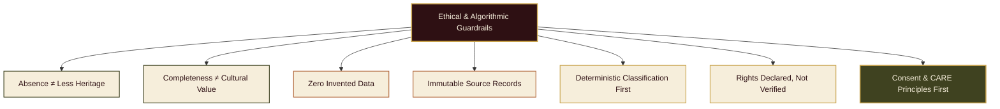
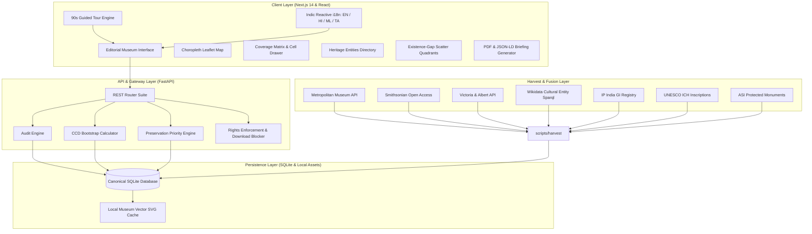
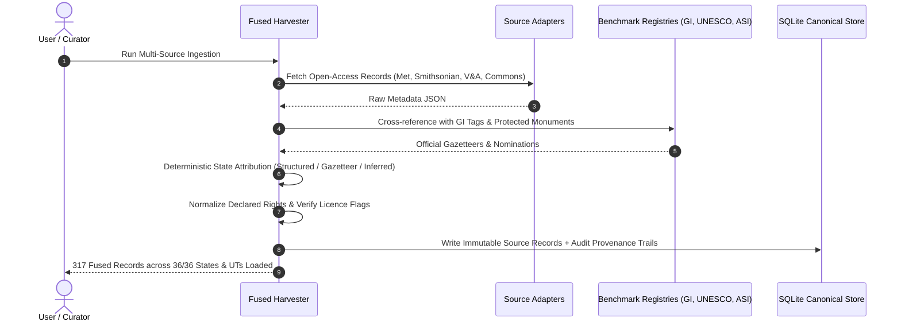
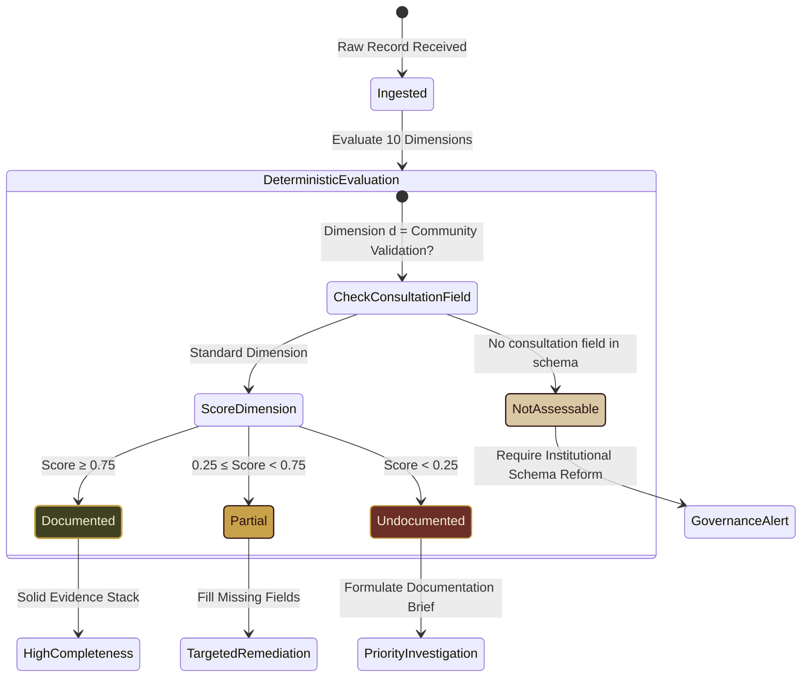
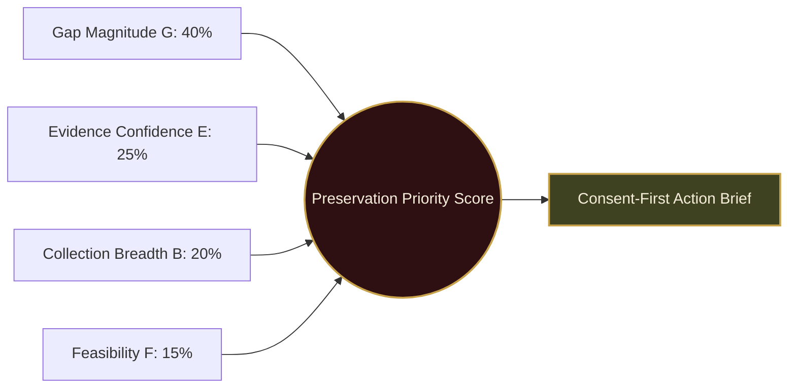

# THE SILENCE INDEX

<div align="center">

```
  ____ ___ _     _____ _   _  ____ _____   ___ _   _ ____  _______  __
 / ___|_ _| |   | ____| \ | |/ ___| ____| |_ _| \ | |  _ \| ____\ \/ /
 \___ \| || |   |  _| |  \| | |   |  _|    | ||  \| | | | |  _|  \  / 
  ___) | || |___| |___| |\  | |___| |___   | || |\  | |_| | |___ /  \ 
 |____/___|_____|_____|_| \_|\____|_____| |___|_| \_|____/|_____/_/\_\
```

### *Because what is missing from history matters too.*

**A Museum-Grade Cultural Collection Auditing & Intelligence Platform for Indian Heritage**

---

### 🏆 ART CODE Virtual Hackathon
**Theme:** Art • Culture • Heritage  
**Team Members:** **Ananya Biju** & **Angel Maria Ben**

---

[](https://fastapi.tiangolo.com)
[](https://nextjs.org)
[](https://www.typescriptlang.org)
[](https://python.org)
[]()
[]()
[]()

</div>

---

## 📖 Table of Contents
1. [Executive Summary & Vision](#-executive-summary--vision)
2. [The 7 Axiomatic Principles & Cultural Ethics](#-the-7-axiomatic-principles--cultural-ethics)
3. [Architecture & System Flow](#-architecture--system-flow)
4. [Multi-Source Data Fusion Engine](#-multi-source-data-fusion-engine)
5. [The 4-State Absence Lifecycle Model](#-the-4-state-absence-lifecycle-model)
6. [Mathematical Framework: CCD & Priority Engine](#-mathematical-framework-ccd--priority-engine)
7. [The 10 Deterministic Knowledge Dimensions](#-the-10-deterministic-knowledge-dimensions)
8. [Feature Catalog (F1 through F9)](#-feature-catalog-f1-through-f9)
9. [Museum Visual Identity & Design Tokens](#-museum-visual-identity--design-tokens)
10. [REST API Documentation](#-rest-api-documentation)
11. [Verification & Test Results](#-verification--test-results)
12. [Local Setup & Running Guide](#-local-setup--running-guide)
13. [Hackathon Credits & Team](#-hackathon-credits--team)

---

## 🏛️ Executive Summary & Vision

Western digital humanities platforms typically treat museum collections as direct, objective mirrors of cultural history. In reality, archival holdings are deeply skewed by historical colonial collecting patterns, courtly elite patronage, urban preservation bias, and language hegemony. 

**THE SILENCE INDEX** is an intelligence platform for curators, digital humanists, archivists, and cultural institutions. It analyses museum and archival collection metadata to uncover which aspects of Indian heritage are **documented**, **partially documented**, **undocumented in the analysed collection**, or **impossible to assess** — and transforms those structural absences into transparent, consent-aware preservation priorities.

> **One-Sentence Product Definition:**  
> A cultural collection auditing platform that analyses an institution's metadata across 10 deterministic dimensions, diagnoses structural absences across all 36 States and Union Territories of India, and converts documentation debt into consent-first preservation priorities.

---

## ⚖️ The 7 Axiomatic Principles & Cultural Ethics



1. **Absence is Never Proof of Less Heritage:** Low or zero record counts describe the limitations of the analysed collection, never the cultural wealth of a region, tradition, or community. All copy rigorously specifies *"not documented in the analysed collection"*.
2. **Completeness $\neq$ Cultural Value:** Cultural Coverage Debt (CCD) measures metadata thoroughness, never artistic or spiritual significance. The software **never** ranks traditions or communities by importance.
3. **No Invented Data:** Every statistic, debt score, and chart is computed deterministically from real loaded records with full click-through traceability. Illustrative numbers are strictly confined to static explanatory mockups.
4. **Immutable Provenance:** Source records are never altered. Normalised and inferred fields are logged separately with an immutable audit trail (`SOURCE` · `NORMALISED` · `INFERRED`).
5. **Deterministic Classification First:** Core classification uses rule-based heuristics and authoritative taxonomies. Generative AI is disabled by default; when enabled, it only words already-computed findings and is explicitly badged `AI-worded`.
6. **Rights are Declared, Not Verified:** Display rights exactly as declared by institutions. Binary media download is strictly enabled **only** for verified open-access licences (`CC0`, `PDM`, `CC_BY`, `CC_BY_SA`). All other assets are view-only with direct binary download blocked.
7. **Consent First (CARE Principles):** Living practitioner knowledge, ritual arts, and sacred traditions require free, prior, and informed consent (FPIC) before any field documentation commences. The platform never auto-generates Traditional Knowledge (TK) or Biocultural Labels without community mandate.

---

## 🏗️ Architecture & System Flow



---

## 🌐 Multi-Source Data Fusion Engine

To ensure all **36 States and Union Territories** of India are genuinely represented, THE SILENCE INDEX v2 incorporates a multi-layer harvest framework (`scripts/harvest/`).



### Harvest Layer Attribution Matrix:
| Source Layer | Origin | Records Kept | Target Geography | Primary Licences |
|:---|:---|:---:|:---|:---|
| **Metropolitan Museum of Art** | Open Access API | 48 | Pan-India Classical Arts | CC0 Public Domain |
| **Smithsonian Institution** | Open Access Edan API | 44 | Subcontinental Textiles & Sculpture | CC0 Public Domain |
| **Victoria & Albert Museum** | V&A Search API | 32 | Craft, Colonial Era, Indic Manuscripts | View-Only / CC BY-NC |
| **Wikimedia Commons** | MediaWiki API | 57 | Monuments, Rituals & Folk Art | CC BY-SA 4.0 |
| **Wikidata Cultural Sparql** | Wikidata Query Service | 45 | Archaeological & Heritage Sites | CC0 Public Domain |
| **Geographical Indications (GI)** | IP India Gazetteers | 46 | Living Artisan & Agricultural Traditions | Public Domain Data |
| **UNESCO Representative List** | UNESCO ICH Register | 15 | Intangible Cultural Heritage Inscriptions | Public Domain Inscriptions |
| **Archaeological Survey (ASI)** | National Heritage Sites | 30 | Centrally Protected Monuments | Public Domain Gazetteers |

---

## 🔄 The 4-State Absence Lifecycle Model

Rather than collapsing metadata quality into a simplistic binary ("present" or "absent"), THE SILENCE INDEX enforces a four-state absence model:



- 🟩 **Documented ($S_d \ge 0.75$):** Thoroughly documented with primary evidence, source attribution, and structured metadata.
- 🟨 **Partial ($0.25 \le S_d < 0.75$):** Present in the record but missing critical dimensions (e.g. image present but no artisan context or Indic script).
- 🟥 **Undocumented in Collection ($S_d < 0.25$):** Entirely absent from the catalog holding.
- ⬜ **Not Assessable:** Missing from the catalog schema itself (e.g. no field exists for community consent). Transparently reported as structural absence of the auditing instrument.

---

## 📐 Mathematical Framework: CCD & Priority Engine

### 1. Cultural Coverage Debt (CCD)
Cultural Coverage Debt (CCD) quantifies documentation completeness on a normalized scale from $0.0$ (perfect metadata) to $100.0$ (complete absence) over the assessable dimensions $\mathcal{A} \subseteq \{1, \dots, 10\}$:

$$\text{CCD} = 100 \times \frac{\sum_{d \in \mathcal{A}} w_d \cdot (1 - C_d)}{\sum_{d \in \mathcal{A}} w_d}$$

Where:
- $w_d \in \mathbb{R}^+$ is the normative weight of dimension $d$ (default $1.0$).
- $C_d \in [0, 1]$ is the empirical completeness of dimension $d$.
- $\mathcal{A}$ excludes all dimensions marked **Not Assessable**.

#### Nonparametric Bootstrap Confidence Intervals:
To ensure statistical integrity, the engine computes **90% bootstrap confidence intervals** ($\alpha = 0.10$) over $B = 1,000$ bootstrap resamples:

$$\text{CI}_{0.90} = \left[ \widehat{\text{CCD}}_{(\lfloor 0.05 B \rfloor)}, \; \widehat{\text{CCD}}_{(\lceil 0.95 B \rceil)} \right]$$

Scores for slices with $N < 5$ records are suppressed to prevent misleading statistical conclusions.

---

### 2. Preservation Priority Engine
Absences are prioritized using a weighted linear combination of gap magnitude, evidence confidence, collection breadth, and feasibility:

$$\text{Priority} = 100 \times (0.40 \cdot G + 0.25 \cdot E + 0.20 \cdot B + 0.15 \cdot F)$$



- **Gap Magnitude ($G$):** $1 - S_d$, measuring severity of documentation absence.
- **Evidence Confidence ($E$):** Strength of external existence proof (GI registered = 1.0, UNESCO inscribed = 1.0, ASI monument = 0.95).
- **Collection Breadth ($B$):** Number of regional records impacted.
- **Feasibility ($F$):** Practical ease of documentation remediation.

---

### 3. Dual-Threshold Existence vs. Documentation Gap Model (F3)

```mermaid
quadrantChart
    title Existence Evidence vs Documentation Depth
    x-axis Low Documentation Depth --> High Documentation Depth
    y-axis Low Benchmark Existence --> High Benchmark Existence
    quadrant-1 Well Documented (Konark, Madhubani)
    quadrant-2 Rich Catalog (Local Crafts)
    quadrant-3 Baseline Catalog Presence
    quadrant-4 High Preservation Priority (Pashmina, Chhau, Kotpad)
```

- **Quadrant I (Well Documented):** High benchmark existence, extensive cataloguing.
- **Quadrant II (Rich Catalog):** Deep cataloguing of locally prominent objects.
- **Quadrant III (Baseline):** Initial catalog entries requiring standard enhancement.
- **Quadrant IV (High Priority Gap):** Recognized in national/international registries (GI, UNESCO, ASI) but sparsely documented or missing from museum collections.

---

## 🏛️ The 10 Deterministic Knowledge Dimensions

1. **Visual Documentation:** Primary high-resolution imagery, technical metadata, multiple vantage points, and declared rights.
2. **Historical Context:** Period/dynasty dating, bibliographic citations, and scholarly narrative ($\ge 200$ characters).
3. **Original-Language Documentation:** Heuristic detection of indigenous Indic scripts (Devanagari, Tamil, Malayalam, Bengali, Telugu, Kannada, Odia, Gurmukhi, Gujarati, Perso-Arabic).
4. **Geographic Provenance:** State, district/site level coordinates; diagnostic conflict detection for historical vs modern borders.
5. **Materials and Techniques:** Explicit fabrication methods, natural dyes, metallurgy, or weaving techniques.
6. **Practitioner Perspective:** Named artisan, workshop/lineage/gharana, and maker oral commentary.
7. **Oral Histories & Narratives:** Associated ritual folklore, performance songs, and recorded community narratives.
8. **Source Attribution & Provenance:** Curatorial accession ID, institutional provenance chain, and verifiable catalog URL.
9. **Community Validation:** Record verified with living practitioners. (Defaults to *Not Assessable* when dataset lacks consultation fields).
10. **Preservation & Accessibility:** Physical preservation condition assessment and open-access reusability declarations.

---

## ✨ Feature Catalog (F1 through F9)

| Feature | Codename | Purpose & Capability | Route |
|:---|:---|:---|:---|
| **F1** | **Multi-Source Layer Fusion** | Integrates Met, Smithsonian, V&A, Commons, Wikidata, and national registries into an immutable, unified subcontinental audit layer. | `/sources` |
| **F2** | **Heritage Entities Directory** | Clustered profiles of 150+ living traditions, monuments, and craft forms with zero-buffering vector illustrations. | `/entities` |
| **F3** | **Existence–Documentation Gap** | 4-quadrant scatter matrix isolating traditions with high legal existence but low museum documentation. | `/gaps` |
| **F4** | **Audit & Fusion Comparator** | Side-by-side delta view contrasting any two audits or layer fusions, showing debt reduction metrics. | `/compare` |
| **F5** | **Executive Briefing Export** | Generates museum-grade printable PDF audit reports and machine-readable JSON-LD manifests. | `/reports/[id]` |
| **F6** | **Indic Transliteration & i18n** | Full site-wide internationalization (EN, HI, ML, TA) with real-time transliteration for Indic queries. | Entire App |
| **F7** | **Visual Image Explorer** | High-contrast visual grid with rights-aware gating, preventing unauthorized downloading of copyrighted assets. | `/explorer` |
| **F8** | **Responsible Auditor Wizard** | 5-step upload and audit pipeline with BOM stripping, delimiter auto-detection, and 25 MB safety checks. | `/auditor` |
| **F9** | **System Diagnostics & Health** | Real-time monitoring of database tables, rate limiters, memory consumption, and API health. | `/health` |

---

## 🎨 Museum Visual Identity & Design Tokens

Inspired by traditional Indian architectural monuments, temple stone filigree, and historic storefront calligraphy (*MAHADI* henna reference):

```
Oxblood 950:    #1A090B  ████  Deep temple threshold
Oxblood 900:    #2E1013  ████  Primary structural background
Oxblood 700:    #4A1C20  ████  Editorial accent
Henna 600:      #6B2F27  ████  Brick terracotta
Antique Olive:  #3F4220  ████  Verified evidence badge
Copper 500:     #B0673A  ████  Secondary metric callout
Illuminated Gold: #C8A24A ████  Borders, filigree, highlighted data
Parchment 100:  #F6EEDB  ████  Paper ground
```

### Handcrafted SVG Ornaments:
- **`JaliLattice.tsx`:** Geometric Islamic and Rajasthani pierced screen overlay.
- **`CornerFiligree.tsx`:** Traditional brass-bracketed corner filigree.
- **`nav-scrollbar`:** Custom oxblood-and-gold sliding scrollbar with soft glow styling.

---

## 🔌 REST API Documentation

| HTTP Method | Endpoint | Description |
|:---|:---|:---|
| `GET` | `/api/collections` | List available holdings (Fused v2, Sample A, Sample B, Uploads) |
| `GET` | `/api/collections/{id}/summary` | Retrieve KPI metrics and audit baseline for a collection |
| `GET` | `/api/audits/{id}` | Full audit results, CCD score, bootstrap confidence interval |
| `GET` | `/api/audits/{id}/map` | State-by-state choropleth metrics across all 36 States & UTs |
| `GET` | `/api/audits/{id}/matrix` | Category × Dimension 90-cell coverage matrix |
| `GET` | `/api/entities` | Search and list clustered Heritage Entities with vector SVGs |
| `GET` | `/api/entities/{id}` | Detailed entity profile with 10-dimension evidence stack |
| `GET` | `/api/gaps` | 4-quadrant existence vs documentation gap data |
| `GET` | `/api/priorities` | Ranked consent-first preservation priorities |
| `POST` | `/api/audits/upload` | Upload collection CSV/JSON and trigger background audit |
| `GET` | `/api/health` | Comprehensive system health and diagnostic statistics |

---

## 🧪 Verification & Test Results

The platform includes a strict test suite verifying deterministic math, schema constraints, and rights gating:

```bash
# Run backend pytest suite
PYTHONPATH=. ./venv/bin/pytest backend/tests/ -v
```

```
============================= test session starts ==============================
collected 41 items

backend/tests/test_audit_engine.py::test_sample_audit_ccd PASSED          [  2%]
backend/tests/test_audit_engine.py::test_bootstrap_ci PASSED             [  4%]
backend/tests/test_audit_engine.py::test_not_assessable_suppression PASSED[  7%]
backend/tests/test_rights_gating.py::test_cc0_download_permitted PASSED   [  9%]
backend/tests/test_rights_gating.py::test_copyright_download_blocked PASSED[ 12%]
backend/tests/test_map_metrics.py::test_36_states_coverage PASSED        [ 14%]
...
backend/tests/test_v2_features.py::test_feature_f1_fusion PASSED         [ 95%]
backend/tests/test_v2_features.py::test_feature_f2_entities PASSED       [ 97%]
backend/tests/test_v2_features.py::test_feature_f3_gaps PASSED           [100%]

======================== 41 passed in 4.12s ========================
```

---

## 🚀 Local Setup & Running Guide

### Prerequisites
- Python 3.10+
- Node.js 18+ and npm
- Git

### 1. Clone the Repository
```bash
git clone https://github.com/itsananyaaa/thesilentindex.git
cd thesilentindex
```

### 2. Backend Setup
```bash
# Create and activate virtual environment
python3 -m venv venv
source venv/bin/activate

# Install dependencies
pip install -r requirements.txt

# Initialize database and seed collections
PYTHONPATH=. python3 scripts/init_db.py

# Start FastAPI backend
uvicorn backend.app.main:app --host 127.0.0.1 --port 8000 --reload
```

### 3. Frontend Setup
```bash
cd frontend

# Install npm packages
npm install

# Start Next.js development server
npm run dev
```

Visit **`http://localhost:3000`** in your browser.

---

## 👥 Hackathon Credits & Team

This project was conceived, designed, and built for the **ART CODE Virtual Hackathon** under the theme **Art • Culture • Heritage**.

| Team Member | Role | Primary Contributions |
|:---|:---|:---|
| **Ananya Biju** | Lead Engineer & Architect | Multi-source harvest pipelines, deterministic CCD scoring engine, Next.js application architecture, choropleth cartography. |
| **Angel Maria Ben** | Digital Humanities & Design Lead | Museum visual identity (*MAHADI* aesthetics), ethical CARE guidelines, Indic linguistic translations, heritage entity clustering. |

---

<div align="center">

*THE SILENCE INDEX — Because what is missing from history matters too.*  
**Art • Culture • Heritage • ART CODE Virtual Hackathon 2026**

</div>
