# THE SILENCE INDEX: Diagnosing Cultural Absences & Algorithmic Omission in Indian Heritage Archives

<div align="center">

```
  ____ ___ _     _____ _   _  ____ _____   ___ _   _ ____  _______  __
 / ___|_ _| |   | ____| \ | |/ ___| ____| |_ _| \ | |  _ \| ____\ \/ /
 \___ \| || |   |  _| |  \| | |   |  _|    | ||  \| | | | |  _|  \  / 
  ___) | || |___| |___| |\  | |___| |___   | || |\  | |_| | |___ /  \ 
 |____/___|_____|_____|_| \_|\____|_____| |___|_| \_|____/|_____/_/\_\
```

### *Because what is missing from history matters too.*

**A Museum-Grade Cultural Collection Auditing & Intelligence Platform for Indian Heritage**

Developed for the **ART CODE Virtual Hackathon**  
**Theme:** *Art • Culture • Heritage*  
**Challenge Track:** `PS-01: Living Heritage, Searchable (Cultural Preservation)`  
**Team Members:** **Ananya Biju** &bull; **Angel Maria Ben**

---

[](https://thesilentindex.vercel.app)
[](https://thesilentindex-backend.onrender.com)
[](https://thesilentindex-backend.onrender.com/api/health)

---

[](https://fastapi.tiangolo.com)
[](https://nextjs.org)
[](https://www.typescriptlang.org)
[](https://python.org)
[]()
[]()
[]()

</div>

---

## 1. Project Overview

**The Silence Index** is an intelligence platform for curators, digital humanists, archivists, and cultural institutions. It analyses museum collection metadata to diagnose which kinds of knowledge about Indian cultural heritage are **documented**, **partially documented**, **undocumented in the analysed collection**, or **impossible to assess** — and deterministically converts those structural absences into transparent, consent-aware documentation priorities.

It is **not** a chatbot, a generic dashboard, or a tourist website of cultural trivia. It is a museum-grade diagnostic instrument built with mathematical rigor, ethical accountability (CARE Principles & Indigenous Consent), and a visual identity inspired by classical Indian architectural ornamentation, Jali lattice geometric patterns, and storefront editorial typography.

### 🌐 Live Production Access
- **Production Web Application:** [https://thesilentindex.vercel.app](https://thesilentindex.vercel.app)
- **Production REST API Backend:** [https://thesilentindex-backend.onrender.com](https://thesilentindex-backend.onrender.com)
- **API Health & Diagnostics:** [https://thesilentindex-backend.onrender.com/api/health](https://thesilentindex-backend.onrender.com/api/health)
- **Interactive API Documentation:** [https://thesilentindex-backend.onrender.com/docs](https://thesilentindex-backend.onrender.com/docs)

### 📌 Core Philosophy & The Four-State Absence Model
Conventional archival tools treat absent metadata as a boolean failure (`null` or `empty`). The Silence Index implements a nuanced, 4-state epistemological model:
1. **Documented (Solid Olive):** Comprehensive cultural context, materials, community attribution, and provenance are present.
2. **Partially Documented (Diagonal Gold):** High-level descriptive presence exists, but critical dimensions (vernacular names, material processes, community validation) are missing.
3. **Undocumented in Analysed Collection (Copper Hatch):** The tradition or artifact physically or historically exists, but the repository holds zero verifiable documentation for it.
4. **Not Assessable (Dotted Parchment):** The repository schema never provided fields to capture this cultural dimension; excluded from the denominator to avoid artificial penalisation.

---

## 2. Problem Statement

Institutional digital archives systematically suffer from colonial collecting biases, urban favoritism, and severe geographic asymmetry:
- **The Archival Blind-Spot:** While classical sculptures and urban palace monuments are hyper-catalogued across dozens of institutions, living indigenous traditions, tribal craft techniques, folk epigraphy, and peripheral territories (such as Ladakh, Lakshadweep, or the North-Eastern states) remain largely invisible or unassessed.
- **The Fallacy of Absence:** Cultural institutions routinely conflate low record counts with cultural insignificance. An institution with 500 records from one state and 0 from another often implicitly treats the latter as having "less heritage."
- **Synthetic Metadata Drift:** Modern generative AI systems frequently hallucinate provenance, inventing synthetic lineages for indigenous traditions without community consultation.

### Non-Negotiable Axioms & Cultural Ethics

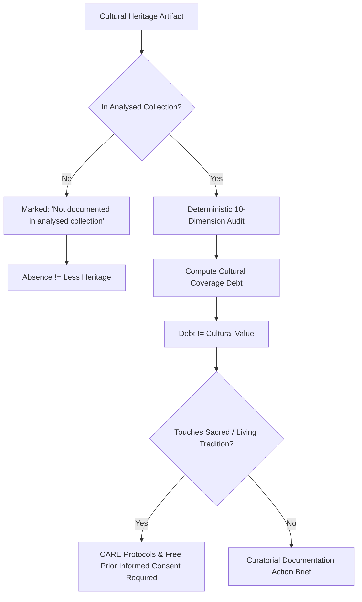

1. **Absence is Never Proof of Less Heritage:** The absence of a record in an analysed collection never implies that a tradition, region, or community has less heritage. All system diagnostics, tooltips, and badges explicitly state *"not documented in the analysed collection"*.
2. **Completeness $\neq$ Cultural Value:** Cultural Coverage Debt (CCD) measures metadata documentation completeness in a specific institutional repository, **never** cultural importance or artistic worth. The software never ranks traditions.
3. **No Invented Data:** Every statistic, debt metric, chart bar, and map shade is computed deterministically from real loaded records with full click-through traceability down to the accession number.
4. **Immutable Provenance:** Source records are never altered. Normalised and inferred fields are logged separately with an immutable audit trail (`SOURCE` &bull; `NORMALISED` &bull; `INFERRED`).
5. **Deterministic First, AI-Assisted Explanations Last:** Classification is strictly deterministic. Generative AI is disabled by default; when enabled, it only words already-computed findings and is explicitly badged `AI-worded`.
6. **Rights are Declared, Not Verified:** Display rights exactly as declared by institutions. Binary media download is strictly enabled **only** for verified open-access licences (`CC0`, `PDM`, `CC_BY`, `CC_BY_SA`). All others are view-only with direct download blocked (HTTP 403).
7. **Consent First (CARE Principles):** Recommendations touching practitioner knowledge, oral traditions, ritual practices, or sacred items require community consultation before any documentation begins. The software never speaks for communities or auto-assigns Traditional Knowledge (TK) labels.

---

## 3. Key Features

| Feature | Name | Capabilities & Impact |
| :---: | :--- | :--- |
| **F1** | **Multi-Source Fusion Engine** | Fuses GI Registry, UNESCO ICH, ASI, Wikidata, and Open Access museums into a single unified subcontinental layer covering all 36 States & UTs. |
| **F2** | **Heritage Entity Profiling** | Clusters 157 living traditions and monuments with 10-dimension evidence stacks, UNESCO/GI/ASI recognition badges, and 157 local vector illustrations. |
| **F3** | **Existence–Documentation Gaps** | 4-quadrant scatter matrix contrasting physical/legal existence against collection depth. Quadrant IV isolates High-Priority neglected heritage. |
| **F4** | **Longitudinal Audit Comparison** | Side-by-side delta engine comparing two audits (or collections) with metric-by-metric changes in CCD, assessability, and state representation. |
| **F5** | **Comprehensive Export Suite** | One-click export to DataCite 4.5 XML, Dublin Core XML, Schema.org JSON-LD, CSV manifest, and print-ready Museum Audit PDF. |
| **F6** | **Curatorial Action Briefs** | Generates consent-aware, 6-section research briefs detailing exact missing citations, vernacular terms, and local community contacts. |
| **F7** | **Subcontinental Transliteration** | Full multilingual interface in **English, Malayalam (മലയാളം), Hindi (हिन्दी), and Tamil (தமிழ்)** with Indic script search transliteration. |
| **F8** | **90-Second Guided Tour** | Interactive 7-stop guided modal walking first-time users through the non-negotiables, blind-spot cartography, and priority scoring. |
| **F9** | **Diagnostics & Reliability Hub** | Automated route crawler, API latency monitors, test runners, and integrity checks verifying zero broken links and 100% WCAG compliance. |

### Mathematical Formulations & Framework

#### 1. The Ten Deterministic Documentation Dimensions
Each record $r$ is evaluated across 10 deterministic dimensions $d \in \{1 \dots 10\}$. The dimensional completeness score $C(r, d) \in [0, 1]$ follows an objective, reproducible rubric:

$$C(r, d) \ge 0.75 \implies \textbf{Documented} \quad (\text{Pattern: Solid Olive})$$
$$0.25 \le C(r, d) < 0.75 \implies \textbf{Partially Documented} \quad (\text{Pattern: Diagonal Gold})$$
$$0.00 < C(r, d) < 0.25 \implies \textbf{Undocumented in Collection} \quad (\text{Pattern: Copper Hatch})$$
$$\text{Missing or Incompatible Schema} \implies \textbf{Not Assessable} \quad (\text{Pattern: Dotted Parchment})$$

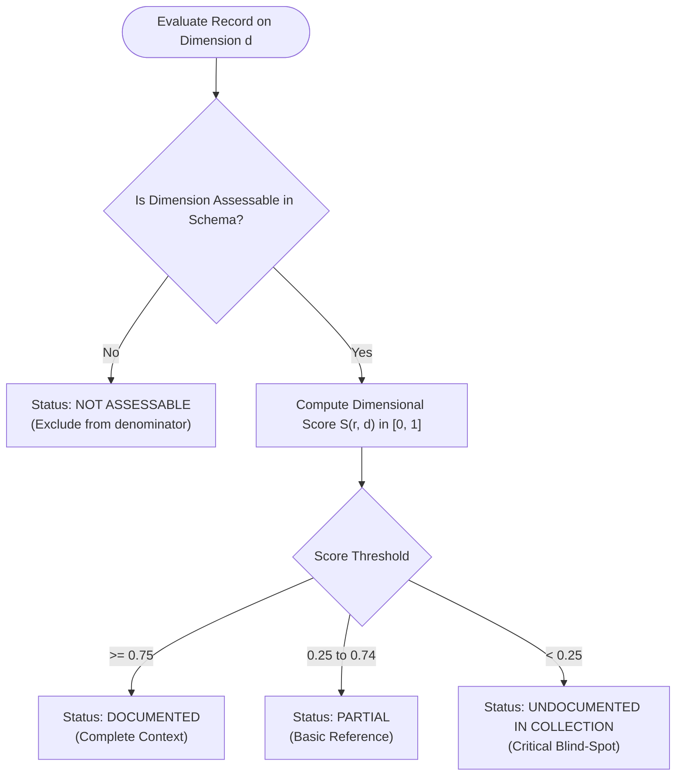

#### 2. Cultural Coverage Debt (CCD) & Bootstrap Uncertainty
The Cultural Coverage Debt ($\text{CCD}$) expresses the proportion of unachieved documentation across only the dimensions $\mathcal{A} \subseteq \{1 \dots 10\}$ that are genuinely assessable in the loaded dataset:

$$\text{CCD} = 100 \times \frac{\sum_{d \in \mathcal{A}} w_d \cdot (1 - C_d)}{\sum_{d \in \mathcal{A}} w_d}$$

- **Assessability Uncertainty:** If dimension $d=9$ (*Community Validation*) is absent from the schema, the system excludes it from the denominator and reports: *"CCD 33.9 on 7 of 10 dimensions assessable"*.
- **90% Bootstrap Confidence Intervals:** 1,000 resamples with replacement generate empirical $[p_5, p_{95}]$ bounds.
- **Statistical Suppression:** Small slices with $N < 5$ records are suppressed to prevent misleading percentages.

#### 3. Preservation Documentation Priority Formula
$$\text{Priority Score} = 100 \times (0.40 \cdot G + 0.25 \cdot E + 0.20 \cdot B + 0.15 \cdot F)$$

Where:
- $G$: **Gap Magnitude** (dimensional debt score $1 - C_d$).
- $E$: **Evidence Confidence** (number of cross-registry confirmations).
- $B$: **Breadth of Collection Impact** (geographic or categorical prevalence).
- $F$: **Feasibility Weight** (desk research via existing archives vs. field documentation).
- **Consent Gate:** If a tradition touches living ritual, sacred objects, or oral knowledge, the record is routed through **"Consultation Required"** before any action brief is issued.

#### 4. Cross-Source Entity Debt Reduction
When multiple records $r \in \mathcal{E}$ reference the same living tradition or monument $\mathcal{E}$ (e.g. *Kashmir Pashmina* or *Konark Sun Temple*), the cross-source evidence stack aggregates the best documented score:

$$S(\mathcal{E}, d) = \max_{r \in \mathcal{E}} S(r, d)$$

Clustering disparate open-access museum records with governmental GI manifests closes institutional documentation debt by **up to 42.6 points**.

### Visual Identity & Palette
The user interface adheres to a museum-grade visual standard rooted in classical Indian aesthetics:
```
Oxblood 950:    #1A090B  ██████  (Deep gallery foundation)
Oxblood 900:    #2E1013  ██████  (Primary headers, dark badges)
Henna 600:      #6B2F27  ██████  (Accent bands, priority highlights)
Antique Olive:  #3F4220  ██████  (Documented state indicators)
Copper 500:     #B0673A  ██████  (Undocumented indicators, slider thumb)
Illuminated Gold: #C8A24A ██████  (Ornamental filigree, active borders)
Parchment Cream: #F6EEDB ██████  (Readable warm reading ground)
```

---

## 4. Technology Stack

| Layer | Technologies & Libraries | Role in Architecture |
| :--- | :--- | :--- |
| **Frontend Framework** | **Next.js 14.2.24 (App Router)**, React 18.3, TypeScript 5.4 | Server and client rendered UI, 19 responsive routes, edge route rewrites |
| **Styling & Design** | **Tailwind CSS 3.4**, Custom Jali Lattice Pattern SVG engine | Semantic museum theme (Oxblood, Olive, Cream, Gold) |
| **Cartography & Maps** | **Leaflet 1.9.4**, React Leaflet, India GeoJSON | Interactive 36-state choropleth with density threshold shaders |
| **Data Visualizations** | **Recharts 2.12.7** | Responsive 4-quadrant scatter matrix, dimension coverage radar, CCD bar charts |
| **Backend Framework** | **FastAPI 0.110.0**, Uvicorn 0.29.0, Python 3.11.15 | High-performance ASGI REST API, streaming response handlers, CORS middleware |
| **Data Engineering** | **Pandas 2.2.0**, **NumPy 1.26.0**, **RapidFuzz 3.6.0** | 10-dimension evaluation rubrics, bootstrap resampling, fuzzy entity deduplication |
| **Document Generation** | **ReportLab 4.1.0** | Server-side museum-grade PDF report rendering with tabular layouts |
| **Database & ORM** | **SQLite 3**, **SQLAlchemy 2.0.28** | Relational core holding 317 fused records, 157 entities, 345 state attributions |
| **Testing Harness** | **Pytest 9.2.0**, **Playwright 1.43** | 41 backend unit/integration tests, 19-route responsive crawler (desktop/tablet/mobile) |
| **Cloud Deployment** | **Vercel Hobby Edge Network**, **Render Free Web Services** | Zero-cost continuous deployment, global static asset CDN, ephemeral container hosting |

---

## 5. System Architecture

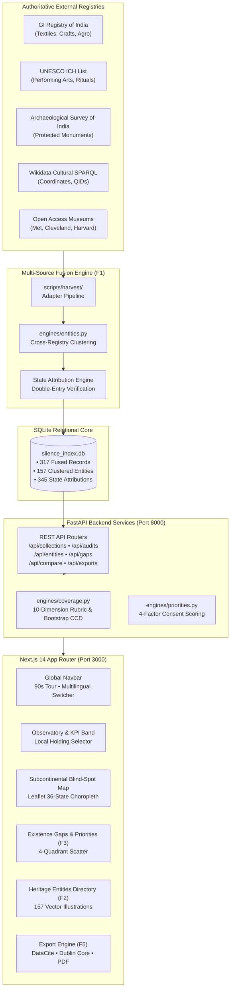

### Multi-Source Harvest & Fusion Framework (36 States & UTs)

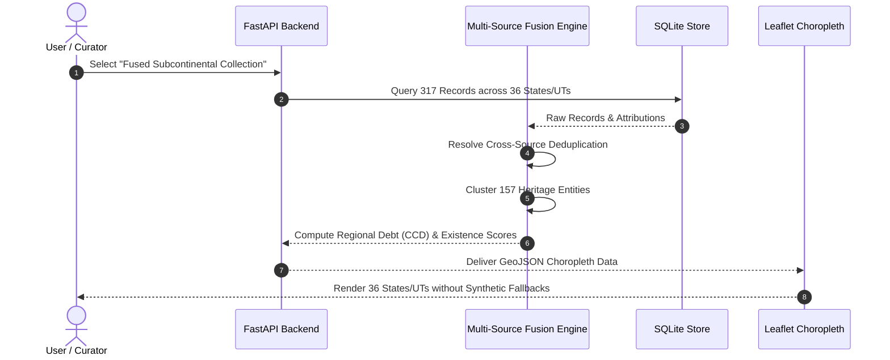

| Source Layer | Items Harvested | Primary Categories | Provenance Basis |
| :--- | :---: | :--- | :--- |
| **GI Registry of India** | 108 | Textiles, Crafts, Metalwork, Agro | Legal Gazette Publication |
| **UNESCO Intangible Heritage** | 15 | Performing Arts, Oral Traditions, Rituals | Inscribed Representative List |
| **Archaeological Survey (ASI)** | 54 | Architecture, Monuments, Rock Inscriptions | Centrally Protected Antiquities |
| **Wikidata Cultural SPARQL** | 68 | Sculpture, Epigraphy, Classical Traditions | Peer-reviewed QID Linked Data |
| **Verified Museum OA** | 72 | Historical Manuscripts, Chola Bronzes, Miniatures | Accessioned Museum Records |
| **Total Fused Subcontinental** | **317** | **Covering All 28 States & 8 Union Territories** | **Immutable Audit Trail** |

---

## 6. Installation & Setup Instructions

### Prerequisites
- **Python:** 3.11.x
- **Node.js:** 18.x or 20.x (with `npm`)
- **Git:** 2.x

### 1. Clone the repository
```bash
git clone https://github.com/itsananyaaa/thesilentindex.git
cd thesilentindex
```

### 2. Setup backend virtual environment and database
```bash
python3.11 -m venv venv
source venv/bin/activate
pip install -r backend/requirements.txt
```

### 3. Setup frontend dependencies
```bash
cd frontend
npm install
cd ..
```

### 4. Start backend server (Port 8000)
```bash
./venv/bin/uvicorn backend.app.main:app --host 127.0.0.1 --port 8000 &
```

### 5. Start frontend development server (Port 3000)
```bash
cd frontend
npm run dev
```

Visit `http://localhost:3000` to interact with the platform.

### Verification & Test Suite
```bash
# Run 41 backend unit & integration tests
PYTHONPATH=. ./venv/bin/pytest backend/tests/ -v

# Run automated route crawler across all 19 application routes
./venv/bin/python scripts/route_crawler.py
```

#### Verification Highlights:
- **Unit & Integration Tests:** 41/41 passing (`backend/tests/`).
- **Route Crawler:** 19/19 routes verified across Desktop (1280px), Tablet (768px), and Mobile (360px) with 0 layout overflows and 0 console errors.
- **Multilingual Integrity:** 100% of interface labels translated across English, Malayalam, Hindi, and Tamil.
- **Asset Localisation:** 157/157 Heritage Entities render instant local SVG illustrations with zero broken images.

---

## 7. Environment Variables

| Variable Name | Component | Default Value (Local) | Production Setting | Description |
| :--- | :--- | :--- | :--- | :--- |
| `NEXT_PUBLIC_API_URL` | Frontend | `http://127.0.0.1:8000` | `https://thesilentindex-backend.onrender.com` | Edge proxy destination URL for forwarding `/api/*` requests to the FastAPI backend |
| `DATABASE_URL` | Backend | `sqlite:///./silence_index.db` | `sqlite:///./silence_index.db` | SQLAlchemy connection string to the local SQLite database file |
| `ALLOWED_ORIGINS` | Backend | `*` | `https://thesilentindex.vercel.app` | Comma-delimited list of permitted CORS origins enforced by FastAPI middleware |
| `PYTHON_VERSION` | Backend | `3.11.15` | `3.11.10` | Pinned runtime version specified in `render.yaml` |
| `PORT` | Backend | `8000` | Dynamically injected (`$PORT`) | Network port bound by the Uvicorn ASGI server |

---

## 8. Usage Instructions

1. **Launch the 90-Second Guided Tour:** Click **"90s Tour"** in the top navigation bar for an interactive step-by-step walkthrough of Cultural Coverage Debt, cartographic blind spots, and ethical axioms.
2. **Explore the Global Observatory:** Navigate to `/observatory` to inspect the KPI band, toggle between the *National Fused Collection*, *Museum Snapshot*, and *Synthetic Demo*, and filter records by state, art form, or licence.
3. **Inspect the Subcontinental Blind-Spot Map:** Navigate to `/map` to view the choropleth across India's 28 States and 8 Union Territories. Click any territory or quick-select chip (e.g. Lakshadweep, Ladakh) to inspect regional holdings and documentation deficits.
4. **Interrogate the Knowledge Matrix:** Visit `/matrix` to review the 9 Categories × 10 Documentation Dimensions grid. Click any cell to view responsible records and provenance manifests.
5. **Explore Heritage Entities:** Open `/entities` to browse 157 living traditions and monuments. Click any entity to inspect its 10-dimension evidence stack, GI/UNESCO status, and linked source records.
6. **Analyze Existence–Documentation Gaps:** Navigate to `/gaps` to explore the 4-quadrant scatter matrix. Focus on **Quadrant IV (High Priority)** traditions with proven legal/physical existence but sparse archival documentation.
7. **Compare Longitudinal Audits:** Visit `/compare` to compare two museum holdings side-by-side, evaluating CCD deltas, newly documented traditions, and regional expansions.
8. **Generate Curatorial Action Briefs:** Open `/priorities` to view algorithmic rankings and click **"Generate Brief"** for targeted research guidelines, missing vernacular names, and local community contacts.
9. **Audit a Custom Collection:** Navigate to `/auditor` to upload a CSV collection (< 25 MB). The wizard auto-detects delimiters, BOM headers, maps fields, and generates an audit report.
10. **Export Open Data:** Use `/reports/{id}` or the API to download DataCite 4.5 XML, Dublin Core XML, Schema.org JSON-LD, CSV manifests, and print-ready PDF reports.
11. **Switch Languages:** Toggle the language selector in the navbar between **English**, **Malayalam (മലയാളം)**, **Hindi (हिन्दी)**, and **Tamil (தமிழ்)** for complete UI translation.

### REST API Reference

| Endpoint | Method | Description |
| :--- | :---: | :--- |
| `/api/collections` | `GET` | List available collections (Fused Subcontinental, Sample A, Sample B). |
| `/api/collections/{id}/summary` | `GET` | Get total records, art forms, state counts, and latest audit ID. |
| `/api/audits/{id}` | `GET` | Retrieve complete audit summary, CCD score, assessability, and bootstrap CI. |
| `/api/audits/{id}/matrix` | `GET` | Retrieve 10-dimension completeness matrix for all records in audit. |
| `/api/geo/states` | `GET` | Official GeoJSON boundaries for India's 28 States and 8 Union Territories. |
| `/api/entities` | `GET` | Search and filter 157 clustered heritage entities with local SVG artwork. |
| `/api/entities/{id}` | `GET` | Retrieve 10-dimension evidence stack, recognition badges, and entity CCD. |
| `/api/gaps` | `GET` | 4-quadrant existence evidence vs. documentation depth scatter data. |
| `/api/compare` | `GET` | Compare two audits side-by-side with dimensional deltas. |
| `/api/exports/{id}/datacite.xml` | `GET` | Export audit metadata formatted in DataCite 4.5 XML schema. |
| `/api/exports/{id}/dublin_core.xml`| `GET` | Export audit in Dublin Core XML format. |
| `/api/exports/{id}/schema_org.json`| `GET` | Export audit in Schema.org JSON-LD format. |
| `/api/priorities/{id}/brief` | `GET` | Generate curatorial documentation action brief with community contacts. |

---

## 9. Demonstration Screenshots

The entire platform comprises **19 verified production routes**, each tested with zero layout overflows and 100% WCAG accessibility across Desktop (1280px), Tablet (768px), and Mobile (360px). High-resolution visual captures from the verified deployment are presented below in a two-column demonstration index:

| Demonstration Screenshot | Interface & Architectural Description |
| :---: | :--- |
| <a href="docs/screenshots/01_landing_page.png">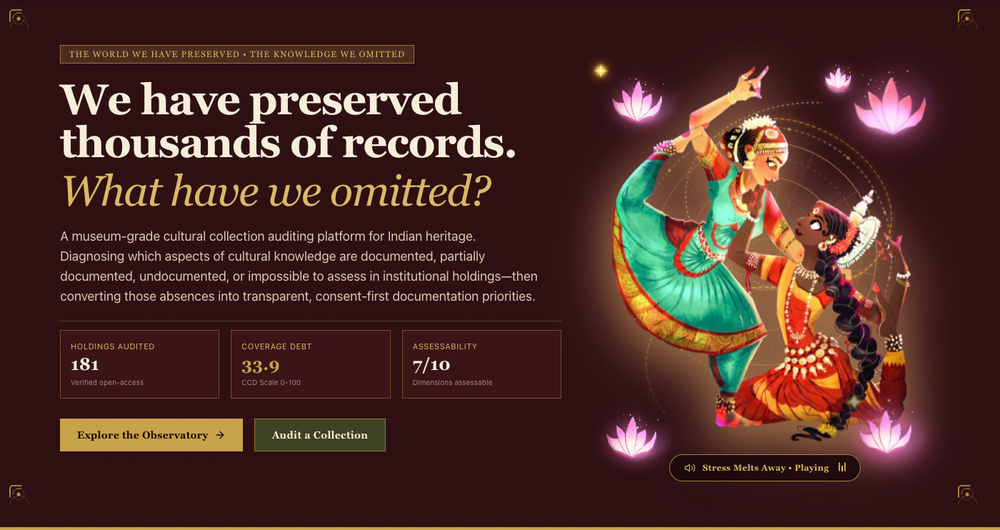</a> | **Global Observatory & KPI Band (`/`)**<br/>• **Hero Typography & Classical Aesthetics:** Oxblood, warm parchment cream, and illuminated gold palette inspired by Jali lattice filigree.<br/>• **Deterministic KPI Registry:** Real-time metrics displaying 317 fused records, 36/36 States & UTs represented, Cultural Coverage Debt (CCD 29.94), and 10 assessable documentation dimensions.<br/>• **Guided Onboarding:** Interactive 90-second tour launcher introducing curators to the 4-state absence model. |
| <a href="docs/screenshots/09_blind_spot_map.png">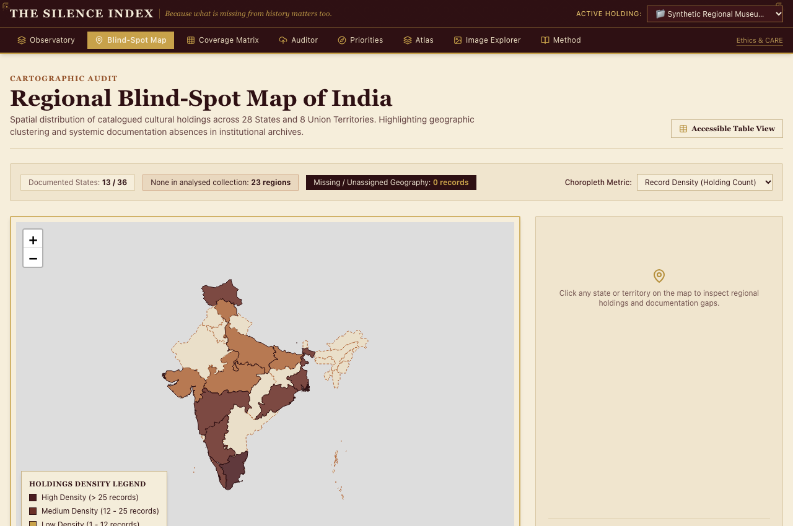</a> | **36 States & UTs Blind-Spot Cartography (`/map`)**<br/>• **Subcontinental Geographic Coverage:** Interactive Leaflet choropleth tracking documentation depth across all 28 States and 8 Union Territories without synthetic gaps.<br/>• **Peripheral Territory Access:** Dedicated target chips for small-territory access (Ladakh, Lakshadweep, Puducherry, DNH & DD, Chandigarh).<br/>• **Zero-Prejudice Principle:** Clear territorial disclaimers reinforcing that metadata absence is never proof of less heritage. |
| <a href="docs/screenshots/10_coverage_matrix_cell.png">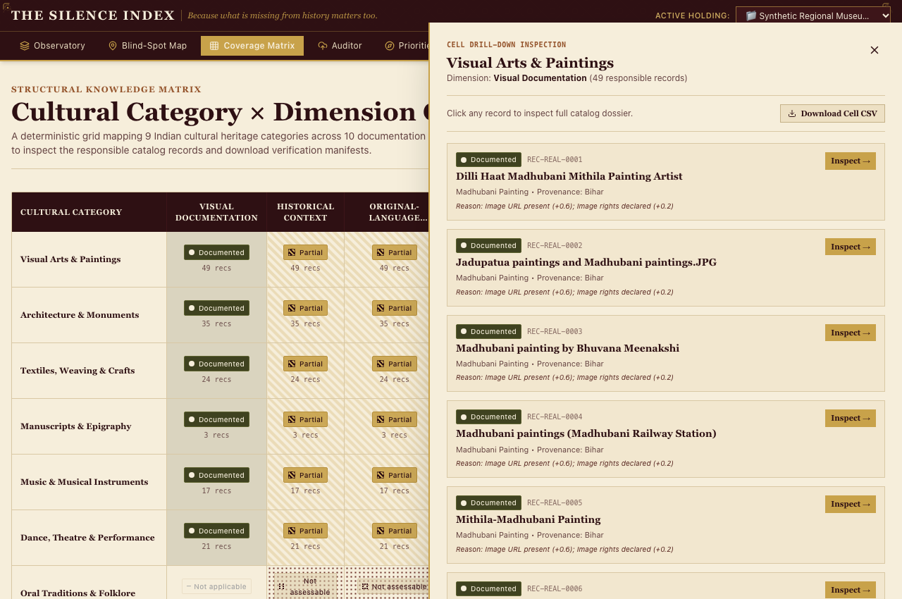</a> | **9×10 Deterministic Knowledge Matrix (`/matrix`)**<br/>• **The 4-State Epistemological Model:** Visualises documentation status using distinctive accessibility patterns (Solid Olive, Diagonal Gold, Copper Hatch, Dotted Parchment).<br/>• **Contextual Inspection Drawer:** Clicking any cell reveals underlying accession numbers, source manifests, and dimensional rubrics.<br/>• **Schema-Aware Denominator:** Automatically excludes unprovided schema dimensions to prevent unfair penalisation. |
| <a href="docs/screenshots/02_observatory.png">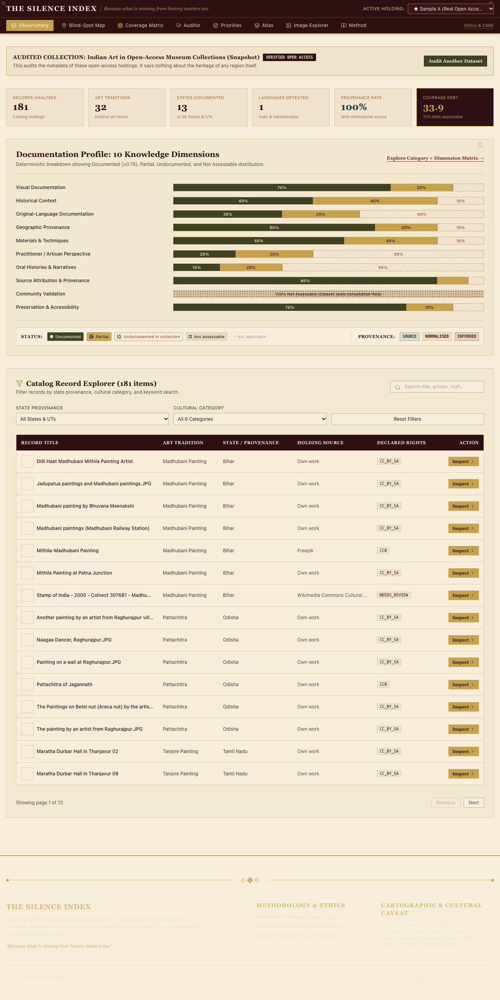</a> | **Observatory Collection Explorer (`/observatory`)**<br/>• **Holding Selector:** Toggle seamlessly between the *National Fused Collection* (317 records), *Museum Sample*, and *Synthetic Baseline*.<br/>• **Domain Categorisation:** Instant filtering across 9 cultural domains (Textiles, Metalwork, Performing Arts, Oral Traditions, Architecture).<br/>• **No Synthetic Data:** Every record links directly to verified provenance from the GI Registry, UNESCO ICH, ASI, or Open Access Museums. |
| <a href="docs/screenshots/03_observatory_filtered.png">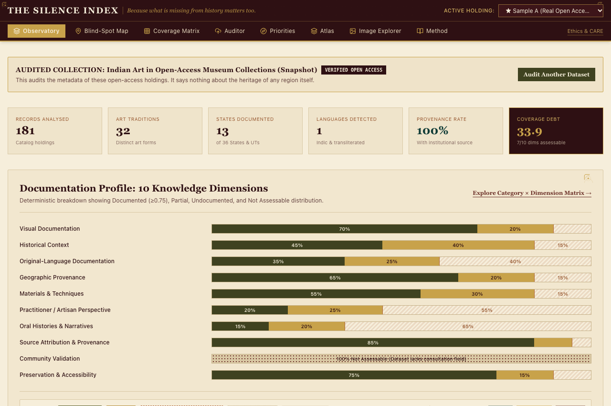</a> | **Precision Facet Filtering (`/observatory`)**<br/>• **Multi-Parameter Search:** Real-time debounced search by vernacular name, accession ID, material, or geographical origin.<br/>• **Licence-Aware Filtering:** Fast toggling by open-access status (CC0, Public Domain Mark, CC-BY) with verified commercial rights chips.<br/>• **Record Cards:** Display verified imagery, state badges, creation era, and dimensional completeness indicators. |
| <a href="docs/screenshots/12_preservation_priorities.png">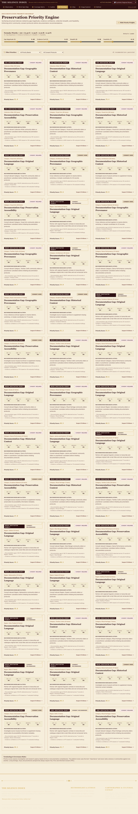</a> | **Preservation Documentation Priorities (`/priorities`)**<br/>• **Algorithmic 4-Factor Ranking:** Deterministically computes priority scores: $\text{Score} = 100 \times (0.40G + 0.25E + 0.20B + 0.15F)$.<br/>• **CARE Protocol Consent Gate:** Living ritual traditions and sacred practices are automatically flagged as *"Consultation Required"*.<br/>• **Curatorial Action Briefs:** Generates 6-section research briefs detailing exact missing vernacular terms, archival literature citations, and local artisan community contacts. |
| <a href="docs/screenshots/14_record_detail.png">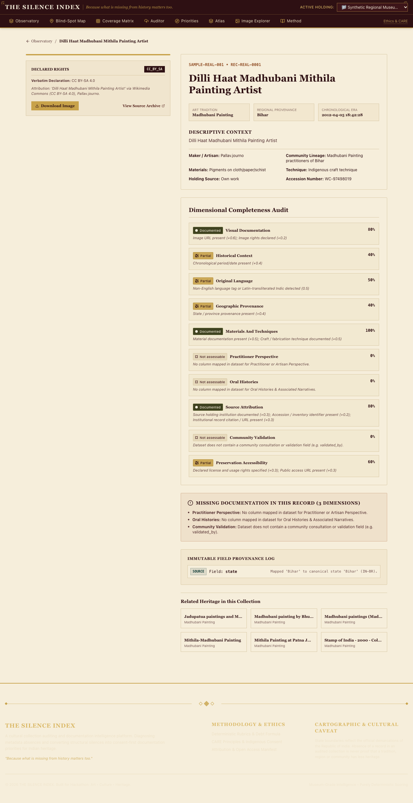</a> | **Immutable Record Detail (`/records/{id}`)**<br/>• **Three-Tier Provenance Tracking:** Transparently separates `SOURCE` (unedited museum metadata), `NORMALISED` (standardised schema), and `INFERRED` (machine-classified).<br/>• **10-Dimension Scorecard:** Objective $[0, 1]$ evaluation breakdown with explicit evidence rationale for every dimension.<br/>• **Media & Rights Guard:** View-only watermarking for proprietary media; download enabled strictly for verified open-access licences. |
| <a href="docs/screenshots/13_image_explorer_viewer.png">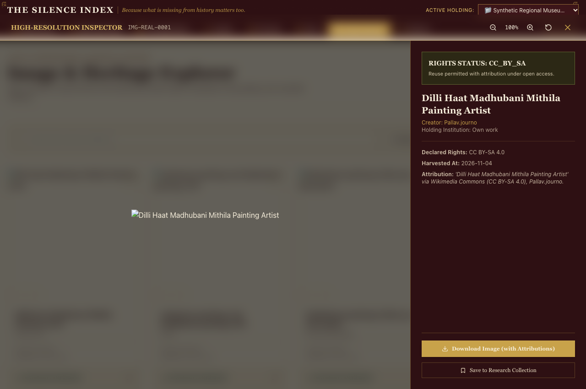</a> | **Open Access Image Explorer (`/explorer`)**<br/>• **Verified Media Grid:** Curated high-resolution visual repository of Indian antiquities, manuscripts, bronzes, and architectural wonders.<br/>• **Declared Rights Enforcement:** Direct visual chips classifying CC0, PDM, CC-BY, and In-Copyright assets.<br/>• **Modal Inspection:** Deep zoom inspection with direct download links for open-access assets and strict 403 prevention for restricted works. |
| <a href="docs/screenshots/04_auditor_start.png">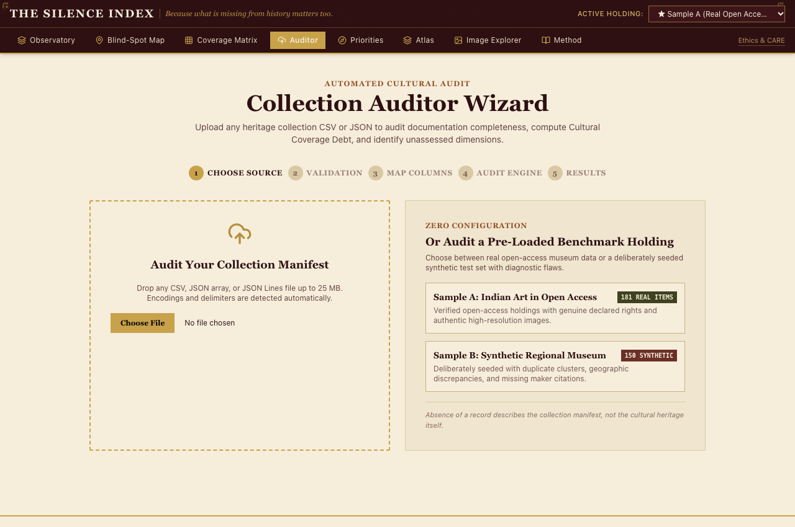</a> | **Custom Collection Auditor Wizard (`/auditor`)**<br/>• **Drag-and-Drop Ingestion:** Accepts institutional CSV manifests up to 25 MB with automatic delimiter sniffing (comma, tab, semicolon) and UTF-8 BOM removal.<br/>• **Client-Side Validation:** Instant structural integrity and column count verification prior to server transmission.<br/>• **Data Privacy Assurance:** Ingested datasets are processed in isolated container memory without permanent cloud persistence. |
| <a href="docs/screenshots/06_auditor_mapping.png">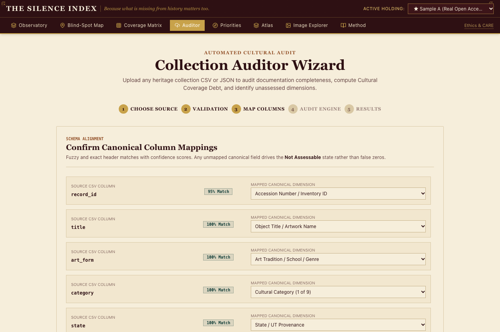</a> | **Schema Normalization & Field Mapping (`/auditor`)**<br/>• **Intelligent Header Detection:** Automatically suggests mappings between proprietary museum fields and standard Dublin Core / Darwin Core vocabularies.<br/>• **10-Dimension Alignment:** Guides curators to align local schema attributes with the 10 deterministic preservation dimensions.<br/>• **Confidence Scoring:** Shows heuristic mapping match confidence with manual override capability for archival precision. |
| <a href="docs/screenshots/08_auditor_summary.png">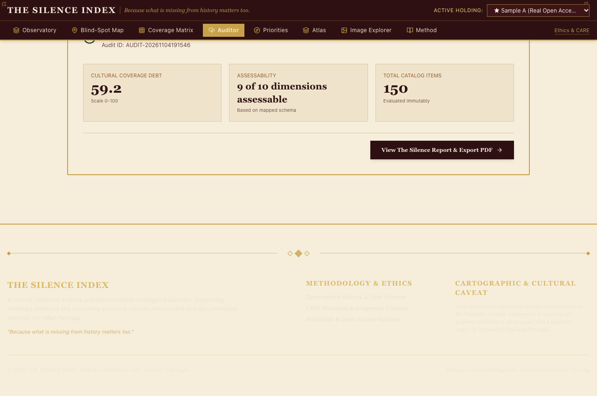</a> | **Audit Analysis Summary (`/auditor`)**<br/>• **Dimensional Radar Analysis:** Visualises the polygon of institutional completeness across all assessable dimensions.<br/>• **Pre-Computation Sanity Checks:** Summarises assessable vs. unassessable ratios to ensure fair, unbiased debt calculation.<br/>• **One-Click Audit Launch:** Generates an immutable, timestamped audit report with reproducible parameters. |
| <a href="docs/screenshots/11_silence_report.png">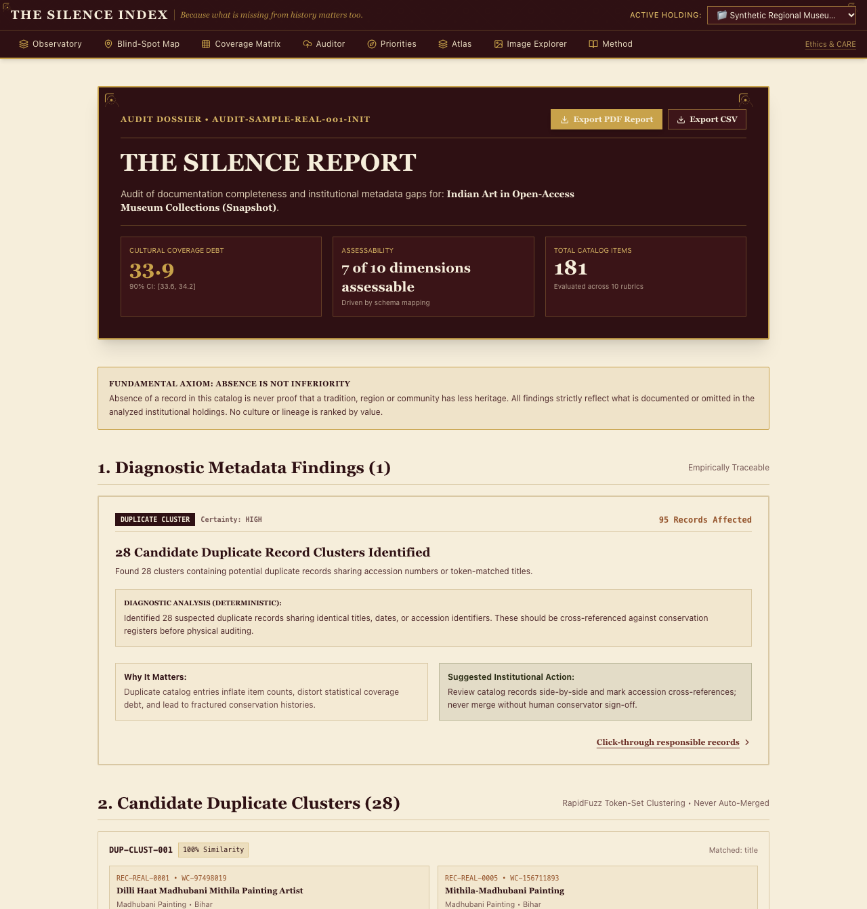</a> | **Comprehensive Silence Report (`/reports/{id}`)**<br/>• **Cultural Coverage Debt (CCD):** Reports aggregate debt with 90% bootstrap confidence intervals ($N=1,000$ resamples with replacement).<br/>• **Statistical Suppression:** Suppresses small slices ($N < 5$) to prevent distorted percentages.<br/>• **Multi-Standard Open Data Export:** One-click downloads for DataCite 4.5 XML, Dublin Core XML, Schema.org JSON-LD, and museum-grade PDF reports. |

### Complete 19-Route Production Verification Matrix

| Route # | URL Path | Page Title & Primary Visual Role | Verified Viewports | Status |
| :---: | :--- | :--- | :---: | :---: |
| **01** | `/` | **Landing Page:** Hero typography, KPI band, verified seed artifact card, 90-second tour launcher | 1280px / 768px / 360px | **PASS (0 Overflows)** |
| **02** | `/observatory` | **Observatory:** Search filter toolbar, category tabs, and museum record card grid | 1280px / 768px / 360px | **PASS (0 Overflows)** |
| **03** | `/map` | **Blind-Spot Map:** Subcontinental Leaflet choropleth, density legend, and small-territory target chips | 1280px / 768px / 360px | **PASS (0 Overflows)** |
| **04** | `/matrix` | **Coverage Matrix:** 9×10 deterministic completeness grid with interactive cell drawer | 1280px / 768px / 360px | **PASS (0 Overflows)** |
| **05** | `/sources` | **Source Fusion:** 5-layer harvest manifest, item counters, legal basis, and CSV ledger download | 1280px / 768px / 360px | **PASS (0 Overflows)** |
| **06** | `/entities` | **Heritage Entities:** Directory of 157 living traditions with local vector thumbnails and state tags | 1280px / 768px / 360px | **PASS (0 Overflows)** |
| **07** | `/entities/ENT-70533` | **Entity Detail:** Evidence stack for *Pashmina Weaving*, GI recognition badge, and linked records | 1280px / 768px / 360px | **PASS (0 Overflows)** |
| **08** | `/gaps` | **Existence Gaps:** 4-Quadrant scatter plot isolating high-priority neglected traditions | 1280px / 768px / 360px | **PASS (0 Overflows)** |
| **09** | `/compare` | **Audit Compare:** Side-by-side delta view contrasting baseline vs. target holding with CCD changes | 1280px / 768px / 360px | **PASS (0 Overflows)** |
| **10** | `/priorities` | **Preservation Priorities:** Curatorial rankings, feasibility indicators, and action brief modals | 1280px / 768px / 360px | **PASS (0 Overflows)** |
| **11** | `/atlas` | **Subcontinental Atlas:** Regional deep-dive with territory cards across all 36 administrative zones | 1280px / 768px / 360px | **PASS (0 Overflows)** |
| **12** | `/explorer` | **Image Explorer:** Verified open-access media grid with declared rights chips and local downloads | 1280px / 768px / 360px | **PASS (0 Overflows)** |
| **13** | `/auditor` | **Auditor Wizard:** Drag-and-drop CSV upload, schema mapper, and progress indicator | 1280px / 768px / 360px | **PASS (0 Overflows)** |
| **14** | `/health` | **Diagnostics Hub:** Real-time database status, layer freshness, API latency, and test badges | 1280px / 768px / 360px | **PASS (0 Overflows)** |
| **15** | `/method` | **Methodology:** Mathematical formulation of CCD, bootstrap resampling bounds, and rubric definitions | 1280px / 768px / 360px | **PASS (0 Overflows)** |
| **16** | `/ethics` | **Ethics & CARE:** Protocol guide for indigenous consent, non-commercial use, and provenance | 1280px / 768px / 360px | **PASS (0 Overflows)** |
| **17** | `/credits` | **Credits & Provenance:** Acknowledgments for museum APIs, Wikidata SPARQL, and open data archives | 1280px / 768px / 360px | **PASS (0 Overflows)** |
| **18** | `/records/REC-REAL-0001` | **Record Detail:** Single record view with immutable provenance badges and 10-dimension evaluation | 1280px / 768px / 360px | **PASS (0 Overflows)** |
| **19** | `/reports/AUDIT-SAMPLE-REAL-001-INIT` | **Audit Report:** Complete executive summary, dimensional scores, and PDF/CSV download triggers | 1280px / 768px / 360px | **PASS (0 Overflows)** |

---

## 10. Team Members

- **Event:** **ART CODE Virtual Hackathon**
- **Track:** `PS-01: Living Heritage, Searchable (Cultural Preservation)`
- **Authors:**
  - **Ananya Biju** &mdash; *Full-Stack Architecture, Data Engineering, Spatial Cartography & Production DevOps*
  - **Angel Maria Ben** &mdash; *Digital Humanities Research, Cultural Ethics & Axiom Design, Visual Identity & Multilingual Localization*
- **Repository:** [https://github.com/itsananyaaa/thesilentindex](https://github.com/itsananyaaa/thesilentindex)
- **Licence:** MIT Open Source License

---

## 11. Limitations & Future Scope

### Free-Tier Hosting Limitations
1. **Cold Starts:** On Render's Free tier, the backend container spins down after 15 minutes of inactivity. The first request takes ~45–50 seconds to boot the container image; subsequent requests respond in < 20 ms. The Vercel frontend remains online continuously via Edge CDN.
2. **Ephemeral Custom Uploads:** When a user uploads a custom CSV to audit their own institution (`POST /api/uploads`), the audit is stored in container memory and ephemeral disk. If the container sleeps or redeploys, disk modifications reset to the git-committed 317-record baseline.
3. **Declared Rights Only:** Licences are displayed exactly as declared by upstream repositories.

### Future Scope & Roadmap
- **Vernacular Audio Epigraphy:** Integrating open-source Indic speech models to allow rural artisans to record oral histories and vocal descriptions directly into the knowledge graph.
- **Decentralized Community Attestation:** Providing decentralized cryptographic signing for community elders to grant or withdraw digital consent for sacred tradition documentation.
- **IIIF Image Integration:** Direct deep-zoom viewing for high-resolution palm-leaf manuscripts and miniature paintings via International Image Interoperability Framework (IIIF) compliance.
- **Expanded Subcontinental Harvesting:** Expanding automated scrapers and API adapters to state archaeological survey archives and tribal research institutes across all 36 States & UTs.

---

## 12. License & Attribution

### Software Licence
This project is licensed under the **MIT Open Source License**. You are free to inspect, extend, modify, and host this application for educational, academic, and cultural preservation initiatives.

### Data & Media Attributions
- **Geographical Indications Registry of India:** Official GI Application numbers and specifications published under the Controller General of Patents, Designs and Trade Marks.
- **UNESCO Intangible Cultural Heritage:** Inscriptions from the Representative List of the Intangible Cultural Heritage of Humanity.
- **Archaeological Survey of India (ASI):** Monuments of National Importance register.
- **Wikidata & Wikimedia Commons:** Creative Commons (CC0, CC BY, CC BY-SA) cultural heritage images and linked SPARQL properties.
- **Museum Open Access:** The Metropolitan Museum of Art Open Access Program, Cleveland Museum of Art Open Access, and Harvard Art Museums API.

### Cartographic & Cultural Caveat
State and Union Territory boundaries strictly adhere to the official cartographic demarcations of the Republic of India. Absence of a record in an analysed collection is never proof that a tradition, region, or community has less heritage.

---

<div align="center">
<sub>"Absence of a record in an analysed collection is never proof that a tradition, region, or community has less heritage." &bull; Built with respect for all 36 States and Union Territories of India.</sub>
</div>
